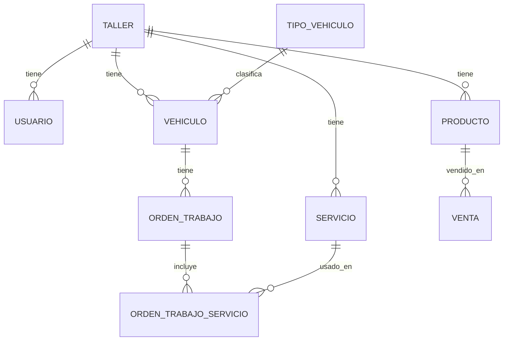

# Modelo de datos

> Motor de base de datos aún sin definir (ver `architecture.md`). Este documento describe el modelo **lógico** (entidades, campos y relaciones), independiente del motor final.

## Convenciones

- Toda tabla propia de un taller tiene `taller_id` (referencia a `Taller`).
- Los catálogos "abiertos" (`TipoVehiculo`, `Servicio`) permiten que cada taller tenga sus propios valores activos/inactivos y agregue los suyos.
- Los módulos `Producto` y `Venta` se listan como esqueleto mínimo: su detalle de campos queda pendiente de una definición propia (ver `mvp.md`).

## Diagrama de entidades (alto nivel)

## Entidades

### Taller

Representa a cada taller que usa el sistema. Hoy hay un único registro; el modelo ya soporta más.

| Campo | Tipo | Notas |
|---|---|---|
| id | identificador | PK |
| nombre | texto | |
| activo | booleano | |
| fecha_alta | fecha/hora | |

### Usuario

Quien inicia sesión en el sistema (dueño/empleado del taller). Sin sistema de roles granular en el MVP.

| Campo | Tipo | Notas |
|---|---|---|
| id | identificador | PK |
| taller_id | referencia → Taller | |
| nombre | texto | |
| email o usuario | texto | único por taller |
| password_hash | texto | nunca texto plano |
| rol | texto/enum | MVP: solo `admin`. Extensible a futuro (`empleado`, etc.) sin cambiar el esquema. |
| activo | booleano | |
| fecha_alta | fecha/hora | |

### TipoVehiculo

Catálogo abierto. MVP: `auto`, `moto`. Pensado para agregar más tipos sin tocar código.

| Campo | Tipo | Notas |
|---|---|---|
| id | identificador | PK |
| nombre | texto | ej. "Auto", "Moto" |
| activo | booleano | |

### Vehiculo

Entidad central del sistema. **No existe entidad Cliente** — el contacto del dueño se guarda directamente acá.

| Campo | Tipo | Notas |
|---|---|---|
| id | identificador | PK |
| taller_id | referencia → Taller | |
| patente | texto | clave de búsqueda principal (historial) |
| tipo_vehiculo_id | referencia → TipoVehiculo | auto / moto |
| marca | texto | opcional |
| modelo | texto | opcional |
| año | número | opcional |
| contacto_nombre | texto | opcional |
| contacto_telefono | texto | usado hoy solo para contacto manual |
| fecha_alta | fecha/hora | |

**Nota de comportamiento (no de esquema):** al cargar una patente que ya existe en el sistema, la aplicación debe *sugerir* autocompletar `contacto_nombre` / `contacto_telefono` con el último valor conocido para esa patente, pero **debe pedir confirmación explícita** antes de guardar (el vehículo pudo haber cambiado de dueño). No implica una tabla nueva: es una consulta sobre `Vehiculo` filtrando por `patente` + `taller_id`.

### Servicio

Catálogo de servicios propio de cada taller (se siembra con valores por defecto al crear el taller, y cada taller puede editar/desactivar/agregar los suyos).

| Campo | Tipo | Notas |
|---|---|---|
| id | identificador | PK |
| taller_id | referencia → Taller | |
| nombre | texto | ej. "Balanceo" |
| categoria_vehiculo | texto/enum | `auto`, `moto`, o ambos |
| aplica_posicion | booleano | si el servicio admite delantero/trasero |
| aplica_lado | booleano | si el servicio admite izquierda/derecha (en la práctica, solo relevante para `auto`) |
| precio_referencia | número, nullable | opcional, se usa como sugerencia al cargar el servicio en una orden |
| activo | booleano | permite "ocultar" un servicio sin borrarlo |

**Lista inicial sugerida para sembrar** (editable): Alineación, Balanceo, Reparación de neumático, Cambio de neumáticos, Rotación, Service de moto, Mecánica general.

### OrdenTrabajo

Representa el paso de un vehículo por el taller. Es el corazón de la sección "Taller".

| Campo | Tipo | Notas |
|---|---|---|
| id | identificador | PK |
| taller_id | referencia → Taller | |
| vehiculo_id | referencia → Vehiculo | |
| usuario_id | referencia → Usuario | quién la registró/actualizó |
| estado | texto/enum | `ingresado`, `en_proceso`, `listo_para_retirar`, `entregado`. Registrar pasos intermedios es **opcional**: se puede cargar todo de una vez al finalizar. |
| fecha_ingreso | fecha/hora | |
| fecha_entrega | fecha/hora, nullable | |
| notas | texto, nullable | |

### OrdenTrabajoServicio

Detalle de servicios aplicados a una orden (una orden puede tener varios).

| Campo | Tipo | Notas |
|---|---|---|
| id | identificador | PK |
| taller_id | referencia → Taller | redundante con `orden_trabajo_id → OrdenTrabajo → taller_id`, pero necesaria: es la tabla de detalle que no tiene otra columna propia para que el filtro automático por taller (ver `backend.md`) la alcance sin depender de un join. Se completa solo, igual que en el resto de las tablas. |
| orden_trabajo_id | referencia → OrdenTrabajo | |
| servicio_id | referencia → Servicio | |
| posicion | texto/enum, nullable | `delantero` / `trasero`, solo si `Servicio.aplica_posicion` |
| lado | texto/enum, nullable | `izquierda` / `derecha`, solo si `Servicio.aplica_lado` (autos) |
| precio_final | número | precargado con `Servicio.precio_referencia`, editable a mano por el empleado |
| notas | texto, nullable | |

### Producto — esqueleto mínimo (pendiente de detalle)

| Campo | Tipo | Notas |
|---|---|---|
| id | identificador | PK |
| taller_id | referencia → Taller | |
| nombre | texto | |
| precio | número | |
| stock_actual | número | puede quedar en negativo (ver `Venta`) |

*Campos adicionales (categoría, proveedor, código, etc.) quedan pendientes — ver `mvp.md`.*

### Venta — esqueleto mínimo (pendiente de detalle)

| Campo | Tipo | Notas |
|---|---|---|
| id | identificador | PK |
| taller_id | referencia → Taller | |
| producto_id | referencia → Producto | |
| cantidad | número | |
| precio_unitario | número | precio al momento de la venta (no depende de que `Producto.precio` cambie después) |
| fecha | fecha/hora | |

*Sin relación a `Vehiculo` ni a un cliente: la venta es independiente. Descuenta stock automáticamente; se permite vender con stock en 0 o negativo.*
